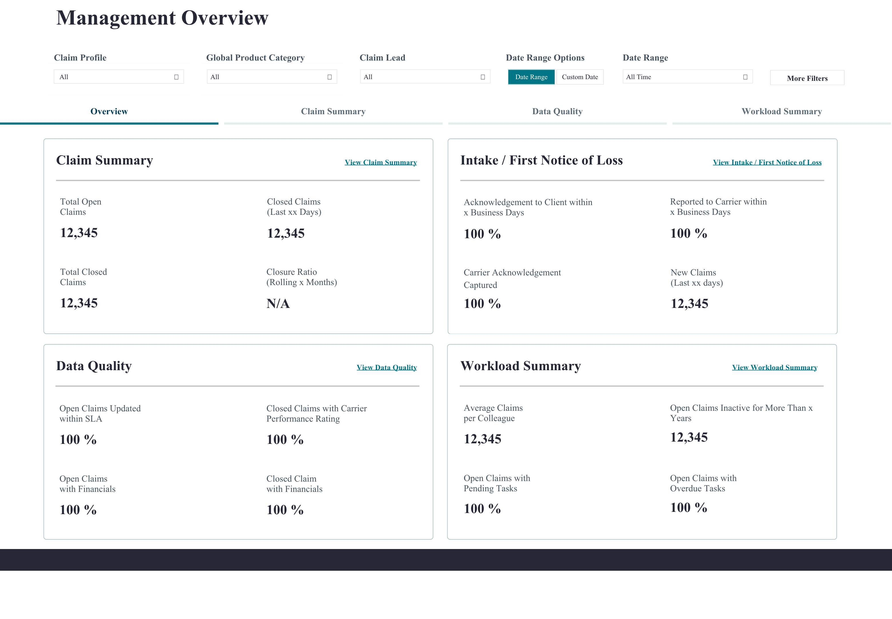
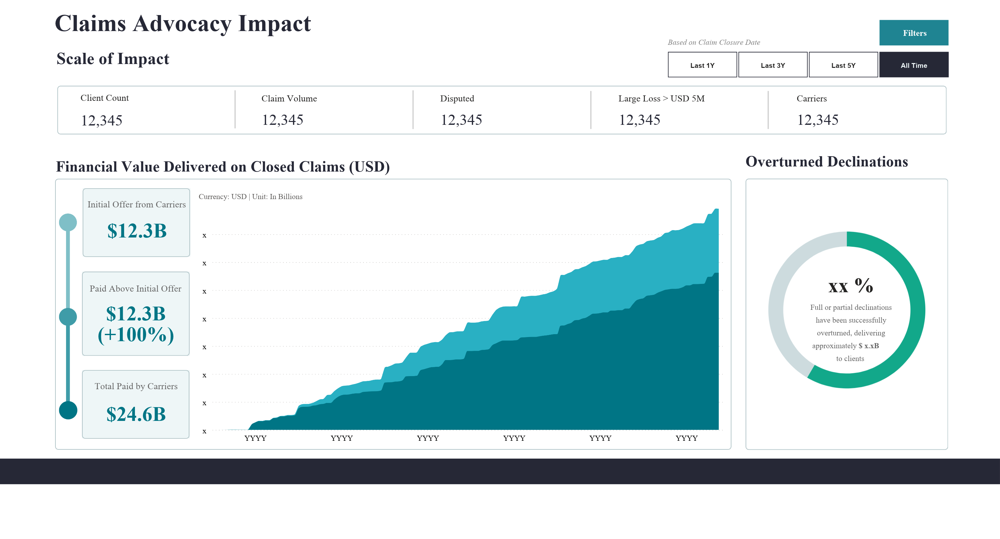
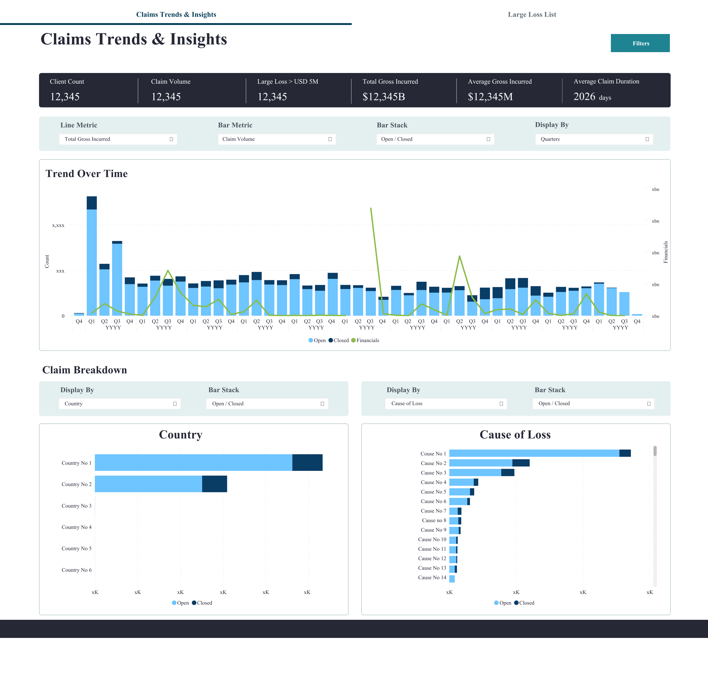
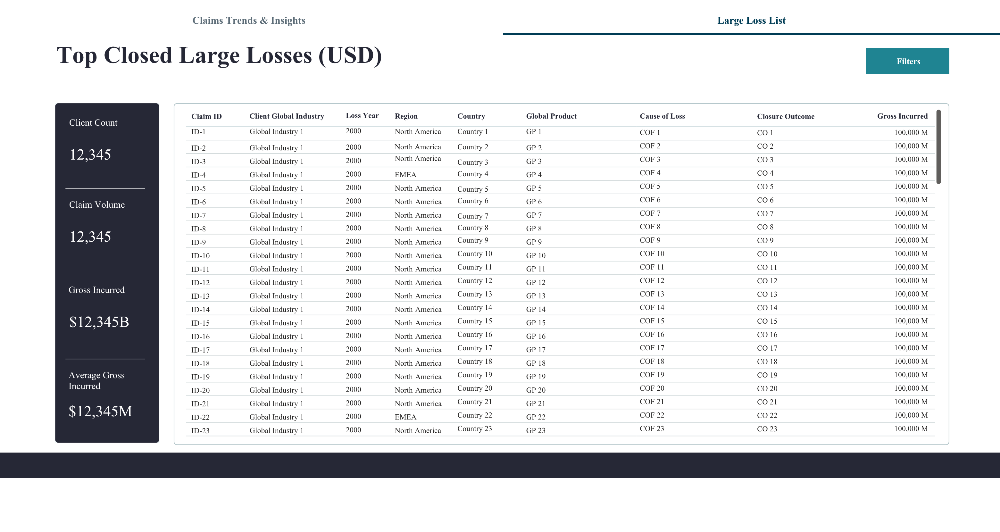
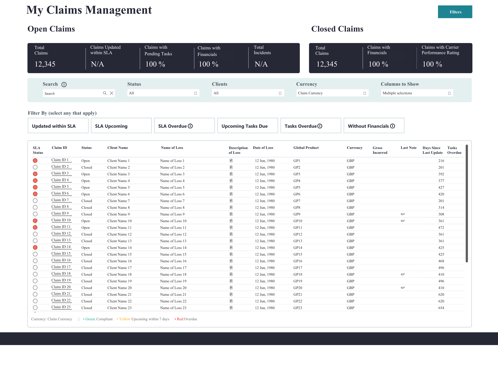

# Arta Roderte - Power BI Portfolio

Welcome to my Power BI portfolio showcasing reporting, analytics, and business intelligence dashboards developed in Power BI.

---

## Management Dashboard

### Description

Executive dashboard providing a high-level overview of operational performance, portfolio activity, and key business metrics. Consists of 4 pages within the dashboard, showcasing only the overview page.

📄 [View PDF](management-overview.pdf)

---

## Claims Advocacy Impact

### Description

Dashboard designed to measure the impact of claims advocacy activities and provide visibility into business outcomes and performance trends.

📄 [View PDF](claims-advocacy-impact.pdf)

---

## Claims Trends & Insights

### Description

Interactive dashboard focused on claims trends, operational insights, and performance monitoring through visual analytics.

📄 [View PDF](claims-trends-insights.pdf)

---

## Top Closed Large Losses

### Description

Dashboard highlighting significant closed claims and large loss events, supporting analysis and management reporting.

📄 [View PDF](top-closed-large-losses.pdf)

---

## My Claims Management

### Description

Operational dashboard designed to support claim ownership, workload monitoring, and day-to-day claims management activities.

📄 [View PDF](my-claims-management.pdf)

---

## About

These dashboards have been included to demonstrate Power BI reporting, dashboard design, KPI monitoring, and data visualization capabilities. Any sensitive information has been anonymized or removed.
